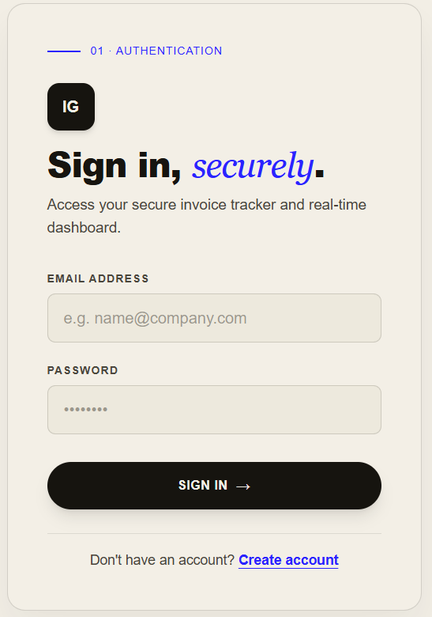
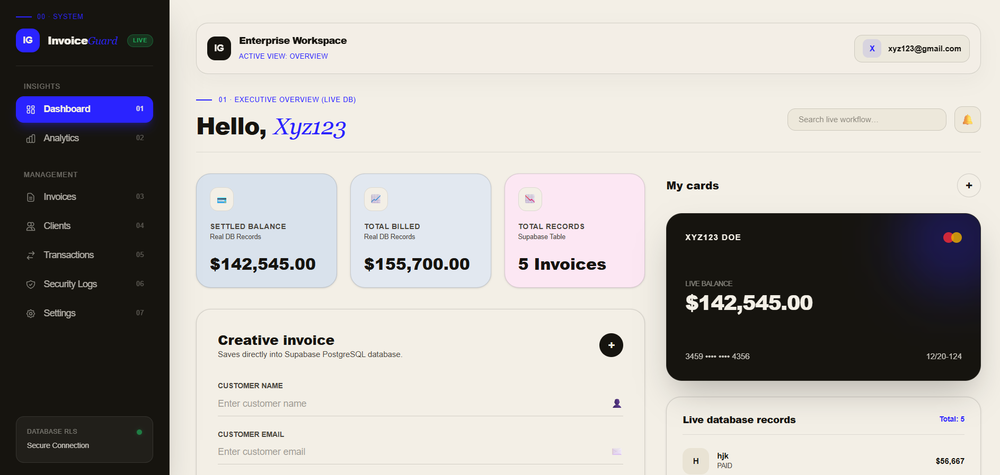
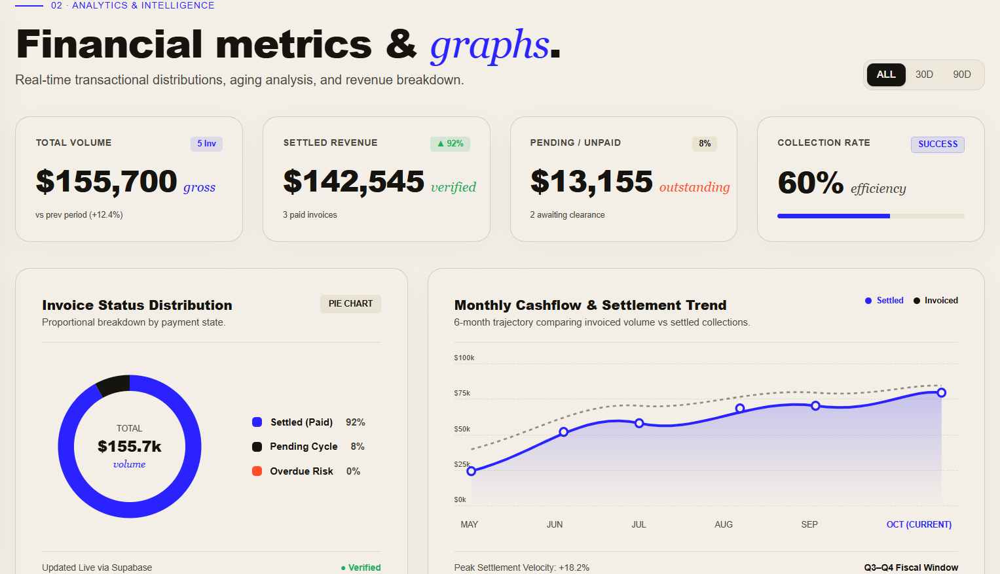
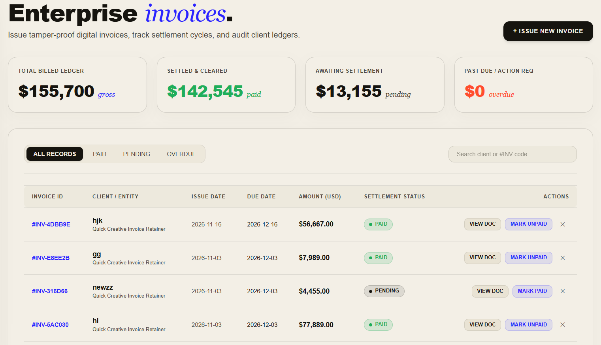
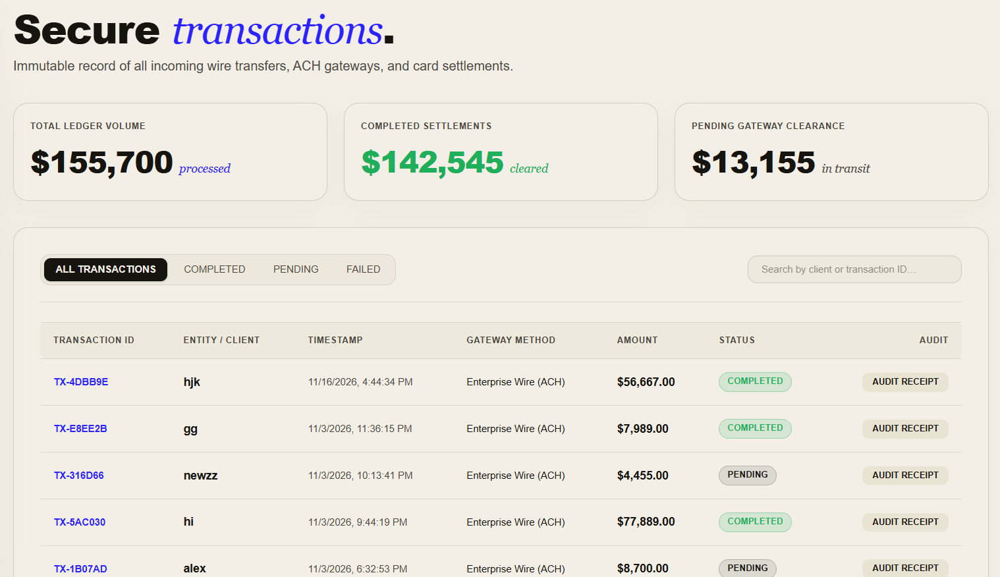
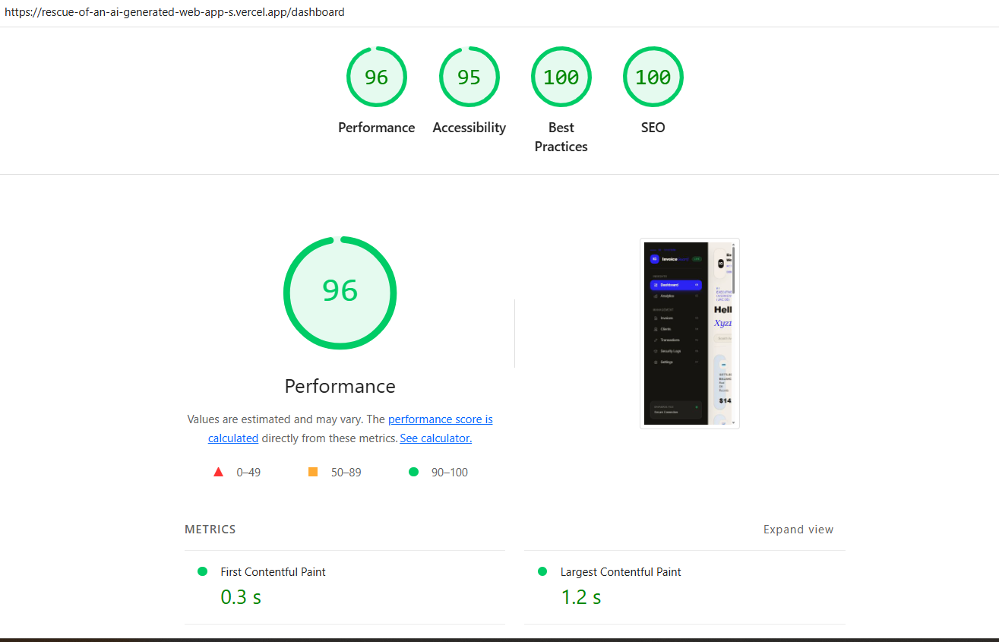

# 🚀 InvoiceGuard — Enterprise Multi-Tenant SaaS Invoice Tracking Platform

<div align="center">

[](https://github.com/nishali26/Rescue-of-an-AI-Generated-Web-App)
[](https://rescue-of-an-ai-generated-web-app-s.vercel.app/login)
[](https://nextjs.org/)
[](https://www.typescriptlang.org/)
[](https://supabase.com/)
[](https://tailwindcss.com/)

</div>

---

## 📌 Executive Overview
**InvoiceGuard** is an advanced, enterprise-grade multi-tenant SaaS application engineered for high-performance financial tracking, client management, and automated invoice lifecycle handling. Developed under rigorous software engineering and quality assurance standards, InvoiceGuard bridges the gap between AI-assisted rapid prototyping and robust production reliability by integrating enterprise-level security (BOLA/IDOR prevention), comprehensive automated testing suites, and automated CI/CD deployment pipelines.

---

## 🔗 Quick Access & Production Links
* **GitHub Source Repository:** [https://github.com/nishali26/Rescue-of-an-AI-Generated-Web-App](https://github.com/nishali26/Rescue-of-an-AI-Generated-Web-App)
* **Live Production Deployment:** [https://rescue-of-an-ai-generated-web-app-s.vercel.app/login](https://rescue-of-an-ai-generated-web-app-s.vercel.app/login)

---

## 📸 Application Interface & Architecture Walkthrough

### 1. Secure Authentication & Access Control
<div align="center">
  
  <p><em>Secure Supabase Authentication Portal enforcing encrypted session management and route guards.</em></p>
</div>

### 2. Live Executive Dashboard & PostgreSQL Integration
<div align="center">
  
  <p><em>Executive Dashboard displaying real-time database metrics, settled balances, and live ledger data.</em></p>
</div>

### 3. Financial Analytics & Intelligence
<div align="center">
  
  <p><em>Financial Metrics & Distribution graphs tracking monthly cashflow, collection velocity, and aging analysis.</em></p>
</div>

### 4. Enterprise Invoices & Ledger Management
<div align="center">
 
  <p><em>Tamper-proof digital invoice tracking with dynamic status toggles (Paid/Pending/Overdue).</em></p>
</div>

### 5. Secure Transactions & Ledger Auditing
<div align="center">
  
  <p><em>Immutable records of incoming wire transfers, ACH gateways, and card settlements.</em></p>
</div>

### 6. Performance Telemetry & Lighthouse Optimization
<div align="center">
  
  <p><em>Production Lighthouse audit verifying top-tier performance (96), accessibility (95), best practices (100), and SEO (100).</em></p>
</div>

<div class="flex flex-row items-center gap-4">




 


</div>
---

## 🛠️ Technology Stack & Architecture
InvoiceGuard is built on a modern, high-performance web stack optimized for enterprise scalability:
* **Frontend Framework:** Next.js (App Router, Server Components, Turbopack)
* **Language:** TypeScript (Strict Type Safety & Compile Checks)
* **Styling & UI:** Tailwind CSS, Lucide Icons, Custom Responsive Dashboards
* **Backend & Database:** Supabase (PostgreSQL, Row Level Security, Secure Auth)
* **Testing Frameworks:** Vitest (Unit & Security Testing), Playwright (End-to-End Testing)
* **CI/CD & Automation:** GitHub Actions, Husky Pre-commit Hooks, Vercel Cloud Infrastructure

---

## 🔒 Enterprise Security Architecture (BOLA / IDOR Mitigation)
Financial multi-tenant SaaS platforms demand uncompromising data isolation. InvoiceGuard implements strict authorization controls:
* **Row-Level Ownership Validation:** All database queries enforce tenant-specific boundary checks.
* **BOLA / IDOR Prevention Tests:** Automated security test suites (`security-bola.test.ts`) simulate unauthorized cross-tenant data access attempts, ensuring immediate exception handling and access denial.
* **Authentication Guards:** Middleware-level session verification protects all protected routes (`/dashboard`), instantly redirecting unauthenticated users to `/login`.

---

## 🧪 Quality Assurance & Testing Pipeline
To ensure enterprise deployment readiness, InvoiceGuard implements a multi-layered testing strategy:
1. **Static Analysis & Linting:** Strict ESLint rules configured to catch syntax anomalies and code smells.
2. **Type Safety Enforcement:** Continuous TypeScript compiler verification (`tsc --noEmit`).
3. **Unit & Integration Testing:** Automated test execution via Vitest covering financial calculation utilities and security boundaries.
4. **End-to-End (E2E) Testing:** Browser automation via Playwright validating authentication workflows across major browser engines.

---

## 🚀 Automated CI/CD Pipelines (GitHub Actions)
InvoiceGuard features a fully automated Continuous Integration and Continuous Deployment (CI/CD) workflow:
* **Automated Quality Gates (`ci.yml`):** Every push or pull request triggers a virtual Linux runner executing static linting, TypeScript compilation, security tests, and production compilation (`npm run build`).
* **Continuous Deployment:** Integrated seamlessly with Vercel for instantaneous, zero-downtime production deployments upon successful pipeline validation.

---

## 📦 Local Installation & Setup

To run InvoiceGuard locally on your machine:

```bash
# 1. Clone the repository
git clone [https://github.com/nishali26/Rescue-of-an-AI-Generated-Web-App.git](https://github.com/nishali26/Rescue-of-an-AI-Generated-Web-App.git)

# 2. Navigate to project directory
cd Rescue-of-an-AI-Generated-Web-App

# 3. Install dependencies
npm install

# 4. Configure environment variables (.env.local)
# Add your NEXT_PUBLIC_SUPABASE_URL and NEXT_PUBLIC_SUPABASE_ANON_KEY

# 5. Run development server
npm run dev